  

  
  
  
  

  
  
  

 

<!-- CHESS_BOARD_START -->

  
<code>[ TURN :: Black (Negras) | CLICK A MOVE TO PLAY ]</code>

  
    
  

<code>[ > CLICK TO VIEW & PLAY VALID MOVES ]</code>

| From | Valid Moves |
| :---: | :--- |
| **`a7`** | [a5](https://github.com/riguidix/riguidix/issues/new?title=chess%7Cmove%7Ca7a5&body=Just+click+Submit+new+issue+to+play+a7a5!) • [a6](https://github.com/riguidix/riguidix/issues/new?title=chess%7Cmove%7Ca7a6&body=Just+click+Submit+new+issue+to+play+a7a6!) |
| **`b7`** | [b5](https://github.com/riguidix/riguidix/issues/new?title=chess%7Cmove%7Cb7b5&body=Just+click+Submit+new+issue+to+play+b7b5!) • [b6](https://github.com/riguidix/riguidix/issues/new?title=chess%7Cmove%7Cb7b6&body=Just+click+Submit+new+issue+to+play+b7b6!) |
| **`b8`** | [a6](https://github.com/riguidix/riguidix/issues/new?title=chess%7Cmove%7Cb8a6&body=Just+click+Submit+new+issue+to+play+b8a6!) • [c6](https://github.com/riguidix/riguidix/issues/new?title=chess%7Cmove%7Cb8c6&body=Just+click+Submit+new+issue+to+play+b8c6!) |
| **`c7`** | [c5](https://github.com/riguidix/riguidix/issues/new?title=chess%7Cmove%7Cc7c5&body=Just+click+Submit+new+issue+to+play+c7c5!) • [c6](https://github.com/riguidix/riguidix/issues/new?title=chess%7Cmove%7Cc7c6&body=Just+click+Submit+new+issue+to+play+c7c6!) |
| **`d7`** | [d5](https://github.com/riguidix/riguidix/issues/new?title=chess%7Cmove%7Cd7d5&body=Just+click+Submit+new+issue+to+play+d7d5!) • [d6](https://github.com/riguidix/riguidix/issues/new?title=chess%7Cmove%7Cd7d6&body=Just+click+Submit+new+issue+to+play+d7d6!) |
| **`e7`** | [e5](https://github.com/riguidix/riguidix/issues/new?title=chess%7Cmove%7Ce7e5&body=Just+click+Submit+new+issue+to+play+e7e5!) • [e6](https://github.com/riguidix/riguidix/issues/new?title=chess%7Cmove%7Ce7e6&body=Just+click+Submit+new+issue+to+play+e7e6!) |
| **`f7`** | [f5](https://github.com/riguidix/riguidix/issues/new?title=chess%7Cmove%7Cf7f5&body=Just+click+Submit+new+issue+to+play+f7f5!) • [f6](https://github.com/riguidix/riguidix/issues/new?title=chess%7Cmove%7Cf7f6&body=Just+click+Submit+new+issue+to+play+f7f6!) |
| **`g7`** | [g5](https://github.com/riguidix/riguidix/issues/new?title=chess%7Cmove%7Cg7g5&body=Just+click+Submit+new+issue+to+play+g7g5!) • [g6](https://github.com/riguidix/riguidix/issues/new?title=chess%7Cmove%7Cg7g6&body=Just+click+Submit+new+issue+to+play+g7g6!) |
| **`g8`** | [f6](https://github.com/riguidix/riguidix/issues/new?title=chess%7Cmove%7Cg8f6&body=Just+click+Submit+new+issue+to+play+g8f6!) • [h6](https://github.com/riguidix/riguidix/issues/new?title=chess%7Cmove%7Cg8h6&body=Just+click+Submit+new+issue+to+play+g8h6!) |
| **`h7`** | [h5](https://github.com/riguidix/riguidix/issues/new?title=chess%7Cmove%7Ch7h5&body=Just+click+Submit+new+issue+to+play+h7h5!) • [h6](https://github.com/riguidix/riguidix/issues/new?title=chess%7Cmove%7Ch7h6&body=Just+click+Submit+new+issue+to+play+h7h6!) |

   
  <a href="https://github.com/riguidix/riguidix/issues/new?title=chess%7Cnew&body=Reset+board"><code>[ ./reset_board.sh ]</code></a>

<!-- CHESS_BOARD_END -->

 

  
  

  

