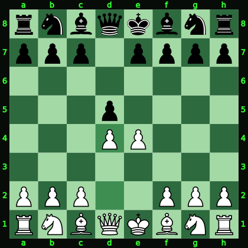

  

  
  
  
  

  
  
  

 

<!-- CHESS_BOARD_START -->

  
<code>[ TURN :: White (Blancas) | CLICK A MOVE TO PLAY ]</code>

  
    
  

<code>[ > CLICK TO VIEW & PLAY VALID MOVES ]</code>

| From | Valid Moves |
| :---: | :--- |
| **`a2`** | [a3](https://github.com/riguidix/riguidix/issues/new?title=chess%7Cmove%7Ca2a3&body=Just+click+Submit+new+issue+to+play+a2a3!) • [a4](https://github.com/riguidix/riguidix/issues/new?title=chess%7Cmove%7Ca2a4&body=Just+click+Submit+new+issue+to+play+a2a4!) |
| **`b1`** | [a3](https://github.com/riguidix/riguidix/issues/new?title=chess%7Cmove%7Cb1a3&body=Just+click+Submit+new+issue+to+play+b1a3!) • [c3](https://github.com/riguidix/riguidix/issues/new?title=chess%7Cmove%7Cb1c3&body=Just+click+Submit+new+issue+to+play+b1c3!) |
| **`b2`** | [b3](https://github.com/riguidix/riguidix/issues/new?title=chess%7Cmove%7Cb2b3&body=Just+click+Submit+new+issue+to+play+b2b3!) • [b4](https://github.com/riguidix/riguidix/issues/new?title=chess%7Cmove%7Cb2b4&body=Just+click+Submit+new+issue+to+play+b2b4!) |
| **`c2`** | [c3](https://github.com/riguidix/riguidix/issues/new?title=chess%7Cmove%7Cc2c3&body=Just+click+Submit+new+issue+to+play+c2c3!) • [c4](https://github.com/riguidix/riguidix/issues/new?title=chess%7Cmove%7Cc2c4&body=Just+click+Submit+new+issue+to+play+c2c4!) |
| **`d2`** | [d3](https://github.com/riguidix/riguidix/issues/new?title=chess%7Cmove%7Cd2d3&body=Just+click+Submit+new+issue+to+play+d2d3!) • [d4](https://github.com/riguidix/riguidix/issues/new?title=chess%7Cmove%7Cd2d4&body=Just+click+Submit+new+issue+to+play+d2d4!) |
| **`e2`** | [e3](https://github.com/riguidix/riguidix/issues/new?title=chess%7Cmove%7Ce2e3&body=Just+click+Submit+new+issue+to+play+e2e3!) • [e4](https://github.com/riguidix/riguidix/issues/new?title=chess%7Cmove%7Ce2e4&body=Just+click+Submit+new+issue+to+play+e2e4!) |
| **`f2`** | [f3](https://github.com/riguidix/riguidix/issues/new?title=chess%7Cmove%7Cf2f3&body=Just+click+Submit+new+issue+to+play+f2f3!) • [f4](https://github.com/riguidix/riguidix/issues/new?title=chess%7Cmove%7Cf2f4&body=Just+click+Submit+new+issue+to+play+f2f4!) |
| **`g1`** | [f3](https://github.com/riguidix/riguidix/issues/new?title=chess%7Cmove%7Cg1f3&body=Just+click+Submit+new+issue+to+play+g1f3!) • [h3](https://github.com/riguidix/riguidix/issues/new?title=chess%7Cmove%7Cg1h3&body=Just+click+Submit+new+issue+to+play+g1h3!) |
| **`g2`** | [g3](https://github.com/riguidix/riguidix/issues/new?title=chess%7Cmove%7Cg2g3&body=Just+click+Submit+new+issue+to+play+g2g3!) • [g4](https://github.com/riguidix/riguidix/issues/new?title=chess%7Cmove%7Cg2g4&body=Just+click+Submit+new+issue+to+play+g2g4!) |
| **`h2`** | [h3](https://github.com/riguidix/riguidix/issues/new?title=chess%7Cmove%7Ch2h3&body=Just+click+Submit+new+issue+to+play+h2h3!) • [h4](https://github.com/riguidix/riguidix/issues/new?title=chess%7Cmove%7Ch2h4&body=Just+click+Submit+new+issue+to+play+h2h4!) |

   
  <a href="https://github.com/riguidix/riguidix/issues/new?title=chess%7Cnew&body=Reset+board"><code>[ ./reset_board.sh ]</code></a>

<!-- CHESS_BOARD_END -->

 

  
  

  

